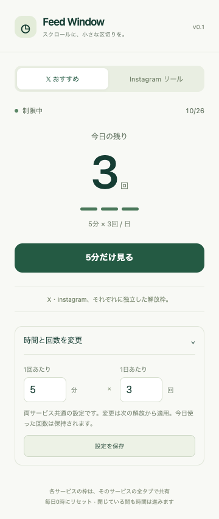

# Feed Window

Xの「おすすめ」とInstagramのリールを、決めた時間と回数だけ見られるようにするSafari Web Extensionです。初期設定は **1回5分 × 1日3回、サービスごとに独立**。ボタンを押したときだけ、そのサービスを解放します。

Mac版Safari向けの開発版です。共通の拡張ソースからChrome向けにも梱包できます。



## できること

- Xホームの「おすすめ」を隠し、「フォロー中」は閲覧できます。
- Instagramのリール画面、リールへの直接リンク、プロフィールのリール一覧、識別できるインラインのリールを隠します。
- X・Instagramをそれぞれ独立して解放し、各サービス内では全タブで時間と回数を共有します。
- 時間切れで再び隠し、対象内の再生中メディアを停止します。
- 1回の時間（1〜120分）と1日の回数（1〜30回）を変更できます。設定値は両サービス共通です。
- 残り時間を表示し、「今すぐ閉じる」で早めに終了できます。
- 設定と使用回数はブラウザ内に保存します。外部サーバー・解析・アカウント登録はありません。

## Safariで使う

必要なもの：macOS、Xcodeとコマンドラインツール、Node.js 20以降。

```sh
git clone https://github.com/szne/FeedWindow.git
cd FeedWindow
npm ci
npm run build:safari
open "dist/Feed Window.app"
```

ビルド結果は `dist/Feed Window.app` です。Safariの「設定 → 拡張機能」でFeed Windowを有効にし、`x.com` と `instagram.com` へのアクセスを許可して、対象ページを再読み込みします。旧ドメインを使う場合は `twitter.com` も許可します。

### 署名

各開発者が自分のMacで署名します。**証明書、秘密鍵、個人の署名設定、署名済みアプリはリポジトリに含めていません。**

- 有効なApple Development署名IDがローカルに1件ある場合、ビルドスクリプトはそれを使います。
- それ以外は簡易署名（ad hoc）を使います。簡易署名の場合、Safariの「設定 → 詳細 → Webデベロッパ用の機能を表示」をオンにし、「デベロッパ → Allow unsigned extensions」もオンにする必要があります。この許可はSafari終了時にリセットされます。
- 開発用証明書による署名を必須にするには、次を使います。

```sh
FEED_WINDOW_SIGNING=development npm run build:safari
```

簡易署名を指定する場合は `FEED_WINDOW_SIGNING=adhoc` を使います。複数の開発用署名IDがある場合は、ローカルで `FEED_WINDOW_IDENTITY` に使用する証明書のSHA-1を指定できます。

Xcodeで設定する場合は、`safari/Feed Window/Feed Window.xcodeproj` を開き、「Feed Window」と「Feed Window Extension」の両ターゲットで **Signing & Capabilities → Automatically manage signing → 自分のTeam** を設定してください。配布する場合は自分用のBundle Identifierも設定します。

生成した署名設定は `work/Signing.generated.xcconfig` に置き、Gitから除外します。秘密鍵はmacOSの署名ツール経由で使用し、スクリプトから書き出しません。署名・ビルドのログにも個人の署名情報が出る場合があるため、ログは公開対象にしません。[公開時の注意](SECURITY.md)

App Store配布やDeveloper IDによる通常配布・公証は、このプロジェクトのビルドフローには含まれません。詳しくは[Appleの実行手順](https://developer.apple.com/documentation/safariservices/running-your-safari-web-extension)を参照してください。

### 一時的な読み込み

「Add Temporary Extension…」に対応するSafariでは、デベロッパ設定から `extension/` フォルダを指定して試すこともできます。署名なしの許可が必要です。一時拡張はSafari終了時または24時間後に削除されます。アプリ版と同時には読み込まないでください。

## Chromeで使う

```sh
npm ci
npm run package:chrome
```

Chromeの `chrome://extensions/` →「デベロッパーモード」→「パッケージ化されていない拡張機能を読み込む」で、生成した `dist/chrome` を選びます。

Safariはイベントページ、Chromeはサービスワーカーを使い、時間・回数・画面制御のコードは共有します。Safari・Chromeそれぞれのストアには公開していません。

## 時間と回数のルール

- 解放した瞬間から時間が進みます。タブを閉じている間やスリープ中も進みます。
- 解放中に再度押しても回数を追加消費せず、時間も延長しません。
- 途中で閉じても使用済み回数は戻りません。
- 毎日ローカル時刻の0時に枠を更新します。0時をまたぐ解放は0時に終了します。
- 時間の変更は次の解放から適用します。回数を変更すると、新しい上限と使用済み回数から残り枠を計算します。
- 再読み込み・ブラウザ再起動でも設定と使用回数を保持します。別の端末・ブラウザ・プロファイルとの同期はありません。

## 開発とテスト

拡張本体にはnpmの実行時依存がありません。npm依存はブラウザテスト用です。

```sh
npm ci
npm test
npm run package:chrome
npx playwright install chromium
npm run test:browser
```

Gitに追加するファイルを確認するときは次を実行します。

```sh
npm run check:publication
```

単体テストと、実際に拡張を読み込んだChromiumのテストがあります。X・Instagramへの通信はDOMフィクスチャに置き換えます。[検証内容と制約](docs/TESTING.md)

```text
extension/           共通の拡張ソース
safari/              macOSアプリとSafari拡張のXcodeプロジェクト
scripts/             ビルド、署名設定の生成、Chrome梱包、公開前チェック
tests/               単体・バックグラウンド・実ブラウザのテスト
docs/                検証記録と画面キャプチャ
work/                ローカルの署名設定・中間生成物・ログ（Git管理外）
dist/                ビルド結果（Git管理外）
```

## 現在の範囲

- macOSのSafari上のWeb版が対象です。iPhone/iPad向けのアプリパッケージはありません。
- X・Instagramのネイティブアプリや、ブラウザで直接開く動画ファイルは対象外です。
- Xはホームの「おすすめ」が対象で、検索やサイドバーのおすすめユーザーは対象外です。
- Instagramでリールへのリンクがない動画など、通常投稿と区別できない表示形式は識別できない場合があります。
- サイトのDOM変更、表示言語、A/Bテストによって判定の調整が必要になることがあります。
- Macアプリのビルドと開発用署名、Chromiumでのフィクスチャテストを確認しています。**Safariでの有効化と、ログイン済みの実サイトでの最終動作確認は未実施です。**

## ライセンス

[MIT](LICENSE)。
